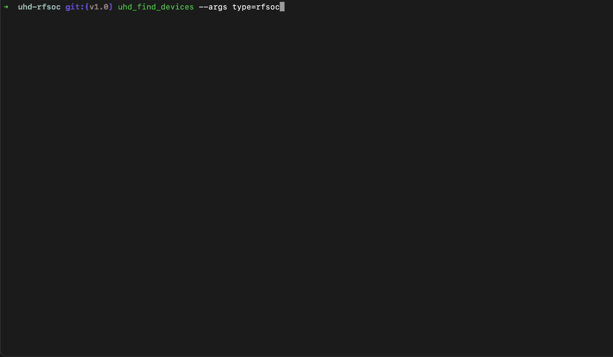
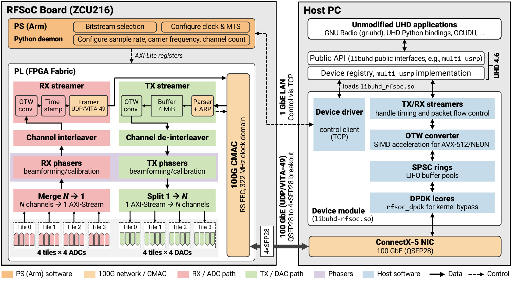
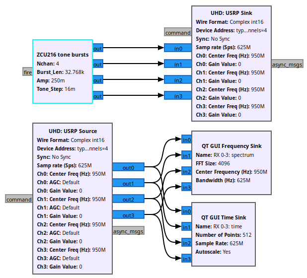
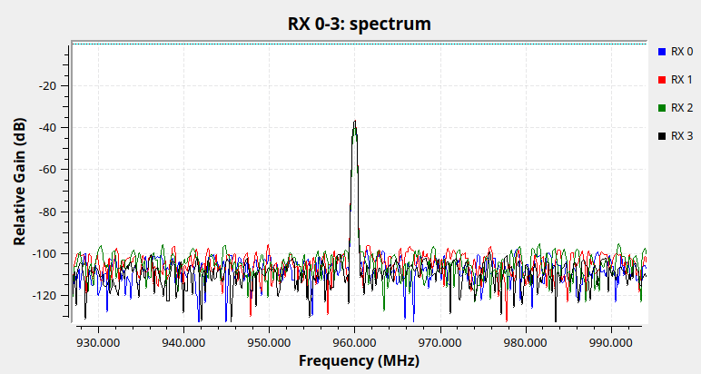
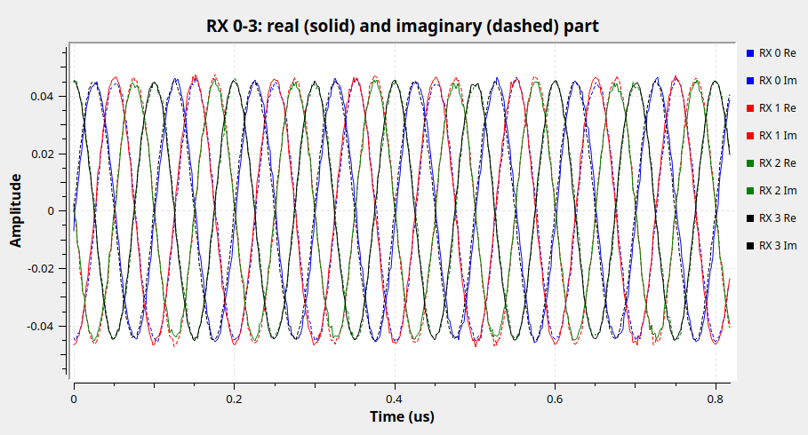
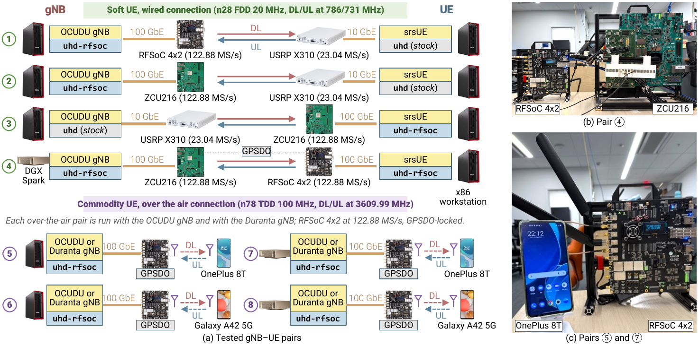

<h1 align="center">uhd-rfsoc</h1>

<p align="center">
  <a href="https://github.com/functions-lab/uhd-rfsoc/actions/workflows/ci.yml"></a>
  <a href="https://arxiv.org/abs/2611.17723"></a>
  <a href="https://github.com/functions-lab/uhd-rfsoc/releases/latest"></a>
  <a href="https://github.com/functions-lab/uhd-rfsoc-bitstream/releases"></a>
  <a href="QUICK_START.md"></a>
  <a href="QUICK_START.md"></a>
  <a href="LICENSE"></a>
</p>

<p align="center">Unleash the full capability of your RFSoC: uhd-rfsoc is an RFSoC driver for UHD, so your board is a standard UHD device.<br>
<b>Every ecosystem built around UHD (GNU Radio, OCUDU, Duranta and more) works out of the box.</b></p>

<p align="center"></p>

<p align="center"><b>Standard UHD tools on a ZCU216:</b> 4 TX and 4 RX channels at 625 MS/s each in sc16, 80 Gb/s each way for 10 s, with no drops, overruns or underruns.<br><a href="QUICK_START.md"><b>▶ Set up your own board in four steps</b></a><br><a href="https://arxiv.org/abs/2611.17723"><b>▶ Read the paper</b></a></p>

## News

- 🔥 **2026-11-14**: [uhd-rfsoc v1.0](https://github.com/functions-lab/uhd-rfsoc/releases/tag/v1.0) is released, with [prebuilt bitstreams](https://github.com/functions-lab/uhd-rfsoc-bitstream/releases/tag/v1.0) for every supported board.
- **2026-11-13**: the paper, [uhd-rfsoc: Bringing Off-the-Shelf RFSoC Boards to Unmodified UHD Applications](https://arxiv.org/abs/2611.17723), is on arXiv.

## Architecture

The board's FPGA streams I/Q samples to the host over a 100 GbE link, a daemon on the board takes control commands over the 1 GbE LAN, and a UHD device module on the host makes the two look like one USRP.

<p align="center"></p>

## Features

<table>
<tr><th>Feature</th><th>Description</th></tr>
<tr>
<td><b>Standard UHD device</b></td>
<td><b>No application changes.</b> The board is a device of <code>type=rfsoc</code>: <code>uhd_find_devices</code>, <code>uhd_usrp_probe</code>, <code>benchmark_rate</code>, the UHD blocks of GNU Radio and the Python <code>uhd</code> bindings run unmodified.</td>
</tr>
<tr>
<td><b>100 GbE data plane</b></td>
<td><b>Wideband streaming without drops.</b> Samples travel as VITA-49-style UDP packets over a 100 GbE link, with DPDK kernel bypass on the host. The demo above carries 80 Gb/s each way.</td>
</tr>
<tr>
<td><b>Run-time sample rate</b></td>
<td><b>The application chooses the bandwidth.</b> A standard UHD rate request sets the rate per channel, from 60 MS/s to 2500 MS/s, with the LTE / 5G NR rates among them. The board retunes itself.</td>
</tr>
<tr>
<td><b>Multi-channel</b></td>
<td><b>1 to 16 channels, aligned.</b> The device argument <code>channels=N</code> selects 1, 2, 4, 8 or 16 TX and RX channels on a ZCU216 (1 or 2 on an RFSoC 4x2), aligned by multi-tile sync like a multi-channel USRP.</td>
</tr>
<tr>
<td><b>Wire formats</b></td>
<td><b>Trade sample width for bandwidth.</b> The FPGA converts between the converters' 16-bit samples and sc16, sc12 or sc8 on the wire, so a narrower format carries a higher rate on the same link.</td>
</tr>
<tr>
<td><b>Beamforming</b></td>
<td><b>TX and RX phasers in the FPGA.</b> One complex weight per channel, set as a steering angle or as raw weights through UHD, for beamforming and calibration.</td>
</tr>
<tr>
<td><b>x86 and Arm hosts</b></td>
<td><b>SIMD on both.</b> The host module builds on x86_64 (AVX-512) and aarch64 (NEON)</td>
</tr>
<tr>
<td><b>5G NR</b></td>
<td><b>A radio for open-source 5G stacks.</b> OCUDU and Duranta gNBs run unmodified with an RFSoC board as their radio, over cable and over the air (<a href="#5g-nr-with-ocudu-and-duranta">below</a>).</td>
</tr>
</table>

## Supported boards

Each board offers several channel counts and sample rates ([Sampling rate options](#sampling-rate-options)).

| Board | Converters | Channel counts (`channels=N`) | Max rate per channel | Carrier range |
|---|---|---|---|---|
| [**Xilinx RFSoC ZCU216**](https://www.amd.com/en/products/adaptive-socs-and-fpgas/evaluation-boards/zcu216.html) | 16T16R | 1, 2, 4, 8, 16 | 1250 MS/s | 0 .. 1250 MHz |
| [**Real Digital RFSoC 4x2**](https://www.realdigital.org/hardware/rfsoc-4x2) | 2T4R | 1, 2 | 2500 MS/s | 0 .. 2500 MHz |
| **Other Xilinx RFSoC boards** | Work in progress | | | |

## Quick start

### Before you run

- **Board:** a ZCU216 or RFSoC 4x2 running PYNQ 2.7, 3.0 or 3.1 ([how to flash it](QUICK_START.md#before-you-start-pynq-on-the-sd-card)), on the LAN, with a QSFP28 100G cable to the host.
- **Host:** Linux (x86_64 or aarch64) with a ConnectX-5, -6 or -7 100G NIC. Tested with UHD 4.6, DPDK 23.11 and GNU Radio 3.10.
- **Bitstreams:** prebuilt for every board and PYNQ version in [uhd-rfsoc-bitstream](https://github.com/functions-lab/uhd-rfsoc-bitstream/releases). The setup fetches the one set your board needs (15-55 MB).

### 1. Set up the board and the host

**[QUICK_START.md](QUICK_START.md)** takes a board with a fresh PYNQ image and a fresh host to the GNU Radio demo in four steps:

1. [Clone](QUICK_START.md#1-clone-on-the-pc) the repository.
2. [Set up the board](QUICK_START.md#2-set-up-the-board-on-the-board-user-xilinx): install the bitstreams and start the daemon.
3. [Set up the host](QUICK_START.md#3-set-up-the-host-on-the-pc): the 100G port, DPDK and the UHD module.
4. [Run](QUICK_START.md#4-run) the demo.

### 2. Discover, probe, stream

The demo at the top of this page is these three standard UHD tools against a ZCU216. The `uhd-rfsoc` wrapper adds `sudo`, which the DPDK data plane needs, and finds UHD's examples.

```sh
# discover the board; no root needed
uhd_find_devices --args type=rfsoc
```

```sh
# probe it as a 4-channel UHD device
uhd-rfsoc uhd_usrp_probe --args type=rfsoc,addr=<board-ip>,channels=4
```

```sh
# stream 4 TX and 4 RX channels at 625 MS/s each in sc16 (80 Gb/s each way) for 10 s
uhd-rfsoc benchmark_rate --args type=rfsoc,addr=<board-ip>,nports=4,channels=4 \
    --channels 0,1,2,3 --rx_rate 625e6 --tx_rate 625e6 \
    --rx_otw sc16 --tx_otw sc16 --rx_cpu sc16 --tx_cpu sc16 --duration 10
```

### 3. Run your own UHD application

```sh
# any UHD application, here a 10 MHz tone on 2 channels at 950 MHz
uhd-rfsoc tx_waveforms --args type=rfsoc,channels=2 --rate 625e6 --freq 950e6 \
    --wave-type SINE --wave-freq 10e6
```

| Device argument | Meaning |
|---|---|
| `addr=<board-ip>` | which board; without it, the one discovery finds |
| `channels=N` | the channel count (default 1); a new N reloads the bitstream (~16 s) |
| `otw=sc8` / `otw=sc12` | a narrower wire format, for the orange and red rates of the [rate table](#sampling-rate-options) |

## Sampling rate options

The data rate $(R)$ on the 100 GbE link (connecting your radio and host machine) is the channel count $(N)$ times the per-channel I/Q sample rate $(f_s)$ times the size of one sample on the wire $(b_{\text{otw}})$:

$$R = N \cdot f_s \cdot b_{\text{otw}} \;\le\;100\ \text{Gb/s}$$

| Symbol | Meaning |
|---|---|
| $N$ | channel count |
| $f_s$ | per-channel I/Q sample rate, which is also the bandwidth |
| $b_{\text{otw}}$ | bits per I/Q sample of the over-the-wire (OTW) format: 32 for sc16, 24 for sc12, 16 for sc8 |

Example with $N = 4$ on a ZCU216:

| $f_s$ (MS/s) | sc16 | sc12 | sc8 | Formats that fit |
|---|---|---|---|---|
| 625 | 80 Gb/s | 60 Gb/s | 40 Gb/s | sc16, sc12, sc8 |
| 833.33 | 107 Gb/s (x) | 80 Gb/s | 53 Gb/s | sc12, sc8 |
| 1250 | 160 Gb/s (x) | 120 Gb/s (x) | 80 Gb/s | sc8 only |

Choose the channel count with the device argument `channels=N` and the sample rate with `--tx_rate` and `--rx_rate`. The OTW format is sc16 by default: pass the device argument `otw=sc8` or `otw=sc12` to ask for a narrower one.

```sh
# 4 channels at 625 MS/s each, sc16 (the default format)
uhd-rfsoc benchmark_rate --args type=rfsoc,channels=4 --channels 0,1,2,3 --rx_rate 625e6 --tx_rate 625e6
```

```sh
# 4 channels at 1250 MS/s each: only sc8 fits
uhd-rfsoc benchmark_rate --args type=rfsoc,channels=4,otw=sc8 --channels 0,1,2,3 --rx_rate 1.25e9
```

### Rates per board and channel count

- **Bold** rates are the LTE / 5G NR rates.
- ${\color{orange}\textsf{Orange}}$ rates are only available for sc12 or sc8. ${\color{red}\textsf{Red}}$ rates are only available for sc8.
- Uncoloured rates fit in every format.

| Board | f_RFDC (GS/s) | Carrier (MHz) | Channels | Max f_s in sc16 / sc12 / sc8 (MS/s) | Supported f_s per channel (MS/s) |
|---|---|---|---|---|---|
| **ZCU216** | 2.5 | 0 .. 1250 | 1 | 1250 / 1250 / 1250 | 62.5, 104.17, 125, 156.25, 208.33, 250, 312.5, 416.67, 500, 625, 833.33, 1250 |
| | | | 2 | 1250 / 1250 / 1250 | 62.5, 104.17, 125, 156.25, 208.33, 250, 312.5, 416.67, 500, 625, 833.33, 1250 |
| | | | 4 | 625 / 833.33 / 1250 | 62.5, 104.17, 125, 156.25, 208.33, 250, 312.5, 416.67, 500, 625, ${\color{orange}\textsf{833.33}}$, ${\color{red}\textsf{1250}}$ |
| | | | 8 | 312.5 / 500 / 625 | 62.5, 104.17, 125, 156.25, 208.33, 250, 312.5, ${\color{orange}\textsf{416.67}}$, ${\color{orange}\textsf{500}}$, ${\color{red}\textsf{625}}$ |
| | | | 16 | 156.25 / 250 / 312.5 | 62.5, 104.17, 125, 156.25, ${\color{orange}\textsf{208.33}}$, ${\color{orange}\textsf{250}}$, ${\color{red}\textsf{312.5}}$ |
| | 2.4576 | 0 .. 1228.8 | 1 | 1228.8 / 1228.8 / 1228.8 | **61.44**, 102.4, **122.88**, 153.6, 204.8, **245.76**, 307.2, 409.6, **491.52**, 614.4, 819.2, 1228.8 |
| | | | 2 | 1228.8 / 1228.8 / 1228.8 | **61.44**, 102.4, **122.88**, 153.6, 204.8, **245.76**, 307.2, 409.6, **491.52**, 614.4, 819.2, 1228.8 |
| | | | 4 | 614.4 / 819.2 / 1228.8 | **61.44**, 102.4, **122.88**, 153.6, 204.8, **245.76**, 307.2, 409.6, **491.52**, 614.4, ${\color{orange}\textsf{819.2}}$, ${\color{red}\textsf{1228.8}}$ |
| | | | 8 | 307.2 / 491.52 / 614.4 | **61.44**, 102.4, **122.88**, 153.6, 204.8, **245.76**, 307.2, ${\color{orange}\textsf{409.6}}$, ${\color{orange}\textsf{\textbf{491.52}}}$, ${\color{red}\textsf{614.4}}$ |
| | | | 16 | 153.6 / 245.76 / 307.2 | **61.44**, 102.4, **122.88**, 153.6, ${\color{orange}\textsf{204.8}}$, ${\color{orange}\textsf{\textbf{245.76}}}$, ${\color{red}\textsf{307.2}}$ |
| | 2.4 | 0 .. 1200 | 1 | 1200 / 1200 / 1200 | 60, 100, 120, 150, 200, 240, 300, 400, 480, 600, 800, 1200 |
| | | | 2 | 1200 / 1200 / 1200 | 60, 100, 120, 150, 200, 240, 300, 400, 480, 600, 800, 1200 |
| | | | 4 | 600 / 800 / 1200 | 60, 100, 120, 150, 200, 240, 300, 400, 480, 600, ${\color{orange}\textsf{800}}$, ${\color{red}\textsf{1200}}$ |
| | | | 8 | 300 / 480 / 600 | 60, 100, 120, 150, 200, 240, 300, ${\color{orange}\textsf{400}}$, ${\color{orange}\textsf{480}}$, ${\color{red}\textsf{600}}$ |
| | | | 16 | 150 / 240 / 300 | 60, 100, 120, 150, ${\color{orange}\textsf{200}}$, ${\color{orange}\textsf{240}}$, ${\color{red}\textsf{300}}$ |
| **RFSoC 4x2** | 5.0 | 0 .. 2500 | 1 | 2500 / 2500 / 2500 | 125, 208.33, 250, 312.5, 416.67, 500, 625, 833.33, 1000, 1250, 1666.67, 2500 |
| | | | 2 | 1250 / 1666.67 / 2500 | 125, 208.33, 250, 312.5, 416.67, 500, 625, 833.33, 1000, 1250, ${\color{orange}\textsf{1666.67}}$, ${\color{red}\textsf{2500}}$ |
| | 4.9152 | 0 .. 2457.6 | 1 | 2457.6 / 2457.6 / 2457.6 | **122.88**, 204.8, **245.76**, 307.2, 409.6, **491.52**, 614.4, 819.2, 983.04, 1228.8, 1638.4, 2457.6 |
| | | | 2 | 1228.8 / 1638.4 / 2457.6 | **122.88**, 204.8, **245.76**, 307.2, 409.6, **491.52**, 614.4, 819.2, 983.04, 1228.8, ${\color{orange}\textsf{1638.4}}$, ${\color{red}\textsf{2457.6}}$ |
| | 4.8 | 0 .. 2400 | 1 | 2400 / 2400 / 2400 | 120, 200, 240, 300, 400, 480, 600, 800, 960, 1200, 1600, 2400 |
| | | | 2 | 1200 / 1600 / 2400 | 120, 200, 240, 300, 400, 480, 600, 800, 960, 1200, ${\color{orange}\textsf{1600}}$, ${\color{red}\textsf{2400}}$ |

## GNU Radio demo

A 4-channel GNU Radio flowgraph with uhd-rfsoc, each DAC cabled to its ADC: 625 MS/s per channel in sc16, a 10 MHz tone on a carrier.

```sh
# ZCU216: 4T4R at 625 MS/s per channel
host/gnuradio/run_tones.sh 4
```

```sh
# RFSoC 4x2: 1T1R at 2500 MS/s
host/gnuradio/run_tones.sh 1 -r 2.5e9
```

| GNU Radio flowgraph | Spectrum of RX 0-3 | RX 0-3 with TX shifted 90° apart |
|:---:|:---:|:---:|
|  |  |  |

- **Standard UHD blocks only:** UHD USRP Sink and Source, Qt GUI sinks.
- **Spectrum:** a clean tone in the expected frequency band.
- **Phaser control:** one phase per TX and RX channel.

The flowgraphs for 1, 2, 4, 8 and 16 channels and their options are in [host/gnuradio/README.md](host/gnuradio/README.md).

## 5G NR with OCUDU and Duranta

Two open-source 5G RAN stacks, [OCUDU](https://ocudu.org) and [Duranta](https://lfnetworking.org/projects/duranta/), run unmodified as Split 8 gNBs with an RFSoC board as their radio.

<p align="center"></p>

<table>
<tr><th>Setup</th><th>Description</th></tr>
<tr>
<td><b>Pairs 1-4, over cable</b></td>
<td><b>OCUDU gNB and srsUE on a 20 MHz FDD cell in band n28.</b> The RFSoC boards run at 122.88 MS/s, the USRP X310 at 23.04 MS/s.</td>
</tr>
<tr>
<td><b>Pairs 5-8, over the air</b></td>
<td><b>A commodity phone on a 100 MHz TDD cell in band n78.</b> The carrier is 3609.99 MHz, in the second Nyquist zone of the RFSoC 4x2.</td>
</tr>
<tr>
<td><b>Hosts</b></td>
<td><b>x86 and Arm.</b> An x86 workstation, or an Arm-based NVIDIA DGX Spark.</td>
</tr>
</table>

## Repository layout

| Path | What | Documentation |
|---|---|---|
| `host/` | the UHD device module, the `uhd-rfsoc` wrapper and the host setup scripts | [host/README.md](host/README.md) |
| `host/gnuradio/` | the GNU Radio flowgraphs | [host/gnuradio/README.md](host/gnuradio/README.md) |
| `host/benchmark/` | tests on a real board over the 100G link | [host/benchmark/README.md](host/benchmark/README.md) |
| `rfsoc/` | the board side: the daemon, the board library and the board setup scripts | [rfsoc/README.md](rfsoc/README.md) |
| `fpga/` | the FPGA build flow, the block designs of each board and the custom IP | [fpga/README.md](fpga/README.md) |
| `bitstreams/` | the prebuilt bitstreams, per PYNQ version and board (submodule) | [uhd-rfsoc-bitstream](https://github.com/functions-lab/uhd-rfsoc-bitstream) |

Troubleshooting: [rfsoc/README.md](rfsoc/README.md) for the board, [host/README.md](host/README.md) for the host.

## Contribute

Bug reports, questions and pull requests are welcome in the [issue tracker](https://github.com/functions-lab/uhd-rfsoc/issues). The `AGENTS.md` files under `host/`, `rfsoc/` and `fpga/` describe the internals and the rules a change has to keep.

## Acknowledgements

uhd-rfsoc is built on these open-source projects, and we are grateful to their authors:

- **[UHD](https://github.com/EttusResearch/uhd)**: the USRP Hardware Driver, whose device interface uhd-rfsoc implements.
- **[GNU Radio](https://www.gnuradio.org)**: the SDR framework of the flowgraph demo.
- **[PYNQ](https://www.pynq.io)**: the framework the board daemon runs on.
- **[DPDK](https://www.dpdk.org)**: the kernel-bypass data plane on the host.
- **[OCUDU](https://ocudu.org)**, **[Duranta](https://lfnetworking.org/projects/duranta/)** and **[srsRAN](https://github.com/srsran/srsRAN_4G)**: the 5G stacks of the gNB and UE tests.

## License

[GPL-3.0-or-later](LICENSE), the license of UHD and GNU Radio. Files that carry their own notice, such as the RFSoC 4x2 board files under `fpga/boards/rfsoc4x2/board_files/`, keep it.

## Citation

If you use uhd-rfsoc in your research, please cite [our paper](https://arxiv.org/abs/2611.17723):

```bibtex
@misc{uhdrfsoc2026,
  title        = {{uhd-rfsoc}: Bringing Off-the-Shelf {RFSoC} Boards to Unmodified {UHD} Applications},
  author       = {Wei Cheng and Yiming Li and Junyao Zheng and Cheng-Bin Chen and Tingjun Chen},
  year         = {2026},
  eprint       = {2611.17723},
  archivePrefix = {arXiv},
  primaryClass = {cs.NI},
  url          = {https://arxiv.org/abs/2611.17723}
}
```
