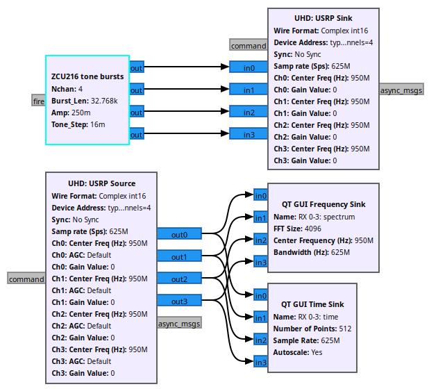
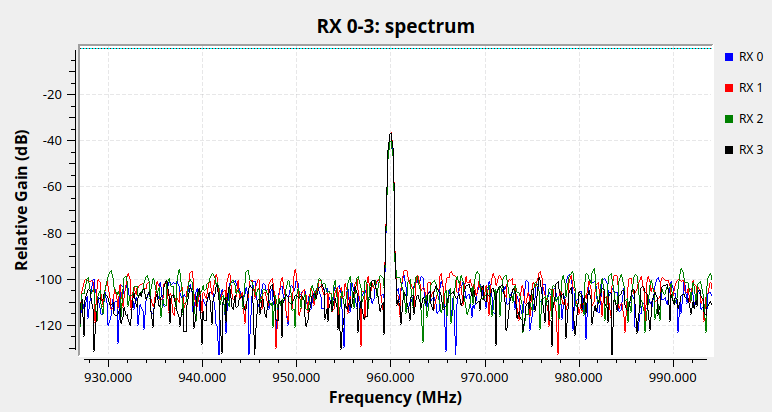
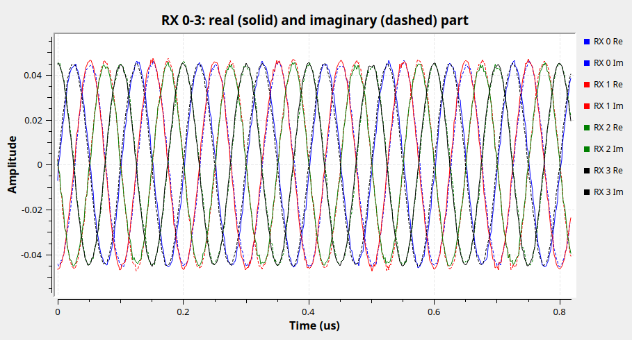
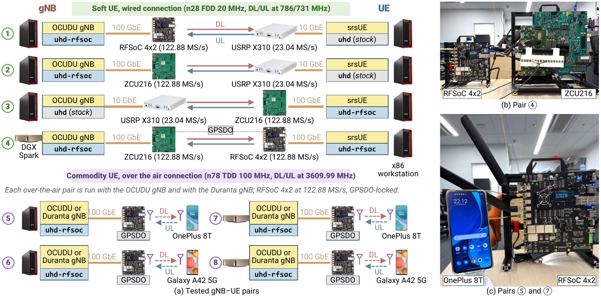

# uhd-rfsoc

[](https://github.com/WeiCheng14159/uhd-rfsoc/actions/workflows/ci.yml)

**uhd-rfsoc turns an AMD RFSoC board into a UHD device over 100 GbE.** Stock
UHD 4.6 applications, GNU Radio flowgraphs and 5G RAN stacks drive the board
as they drive a USRP: up to 16 channels, up to 2.5 GS/s per channel.

<!-- Demo video placeholder. Replace the block below with the video: drag
     the .mp4 into the GitHub editor, or link a thumbnail to it. -->
> **Demo video: coming soon.** The UHD command line against a board:

```sh
uhd_find_devices --args type=rfsoc
uhd-rfsoc uhd_usrp_probe --args type=rfsoc,channels=4
uhd-rfsoc benchmark_rate --args type=rfsoc --rx_rate 1.25e9 --tx_rate 1.25e9
```

## Quick start: clone and run the GNU Radio demo

You need:

- **Board:** a ZCU216 or RFSoC 4x2 running PYNQ 2.7, 3.0 or 3.1, on the LAN,
  with a QSFP28 100G cable to the host.
- **Host:** Ubuntu 24.04 (x86_64 or aarch64) with a ConnectX-5, -6 or -7
  100G NIC. UHD 4.6, DPDK 23.11 and GNU Radio 3.10 are its stock packages.

### 1. Clone, with the prebuilt bitstreams (on the PC)

```sh
git clone git@github.com:WeiCheng14159/uhd-rfsoc.git && cd uhd-rfsoc
git submodule update --init bitstreams      # ~180 MB, fetched over SSH
```

No SSH key, or your own builds: see "Bitstreams" in [More](#more).

### 2. Set up the board (on the board, user `xilinx`)

```sh
git clone https://github.com/WeiCheng14159/uhd-rfsoc.git ~/jupyter_notebooks/uhd-rfsoc
cd ~/jupyter_notebooks/uhd-rfsoc
sudo rfsoc/setup_board.sh                   # once
```

Set `data_ip` in `rfsoc/server/uhd_rfsoc.conf`: the FPGA's 100G address, on
the subnet of the host's 100G port. Then copy the bitstreams from the PC and
start the daemon:

```sh
# on the PC
rfsoc/push_bitstreams.sh bitstreams/pynq<version>/<board> xilinx@<board-ip>
# on the board
./run_daemon.sh                             # returns once it serves (~20 s)
```

### 3. Set up the host (on the PC)

```sh
sudo apt install libuhd-dev uhd-host python3-uhd libboost-dev gnuradio \
    dpdk libdpdk-dev rdma-core ibverbs-providers cmake g++ pkg-config
sudo host/setup_cx5.sh <100g-iface> <host-data-ip>/24   # RS-FEC, MTU 9000, address
sudo host/setup_dpdk.sh <100g-iface> --install          # hugepages, driver checks
sudo nmcli device set <100g-iface> managed no           # keep NetworkManager off the port
cmake -S host -B host/build -DCMAKE_BUILD_TYPE=Release
cmake --build host/build -j && sudo cmake --install host/build
```

### 4. Run

```sh
uhd_find_devices --args type=rfsoc          # the board answers; no root needed
host/gnuradio/run_tones.sh 4                # ZCU216: 4T4R at 625 MS/s per channel
host/gnuradio/run_tones.sh 1 -r 2.5e9       # RFSoC 4x2: 1T1R at 2500 MS/s
```

Run it from a terminal on the PC's desktop; it asks for the sudo password,
because the DPDK data plane needs root. Cable each DAC to its ADC to see the
tones of the [demo below](#gnu-radio-demo).

Any other UHD application runs through the `uhd-rfsoc` wrapper, which adds
`sudo` and finds UHD's examples:

```sh
uhd-rfsoc tx_waveforms --args type=rfsoc,channels=2 --rate 625e6 --freq 950e6 --wave-type SINE --wave-freq 10e6
```

| device argument | meaning |
|---|---|
| `addr=<board-ip>` | which board; without it, the one discovery finds |
| `channels=N` | the channel count (default 1); a new N reloads the bitstream (~16 s) |
| `otw=sc8` / `sc12` | a narrower wire format, for the ° and • rates below |

Troubleshooting: `rfsoc/README.md` for the board, `host/README.md` for the
host.

## Sample rate (bandwidth) and carrier

The per-channel I/Q sample rate f_s is the bandwidth. It is the RFDC rate
f_RFDC divided by an integer factor, and UHD chooses it at run time
(`set_rx_rate`, `--rate`). Each row is one bitstream.

- **Bold** rates are the LTE / 5G NR rates.
- Rates marked ° fit the 100 GbE link only in sc12 or sc8; rates marked •
  fit only in sc8. All others fit in sc16 too.
- The carrier is set per channel anywhere in the range, without an external
  front end.

| board | f_RFDC (GS/s) | carrier (MHz) | channels | max f_s in sc16 / sc12 / sc8 (MS/s) | supported f_s per channel (MS/s) |
|---|---|---|---|---|---|
| **ZCU216** | 2.5 | 0 .. 1250 | 1 | 1250 / 1250 / 1250 | 62.5, 104.17, 125, 156.25, 208.33, 250, 312.5, 416.67, 500, 625, 833.33, 1250 |
| | | | 2 | 1250 / 1250 / 1250 | 62.5, 104.17, 125, 156.25, 208.33, 250, 312.5, 416.67, 500, 625, 833.33, 1250 |
| | | | 4 | 625 / 833.33 / 1250 | 62.5, 104.17, 125, 156.25, 208.33, 250, 312.5, 416.67, 500, 625, 833.33 °, 1250 • |
| | | | 8 | 312.5 / 500 / 625 | 62.5, 104.17, 125, 156.25, 208.33, 250, 312.5, 416.67 °, 500 °, 625 • |
| | | | 16 | 156.25 / 250 / 312.5 | 62.5, 104.17, 125, 156.25, 208.33 °, 250 °, 312.5 • |
| | 2.4576 | 0 .. 1228.8 | 1 | 1228.8 / 1228.8 / 1228.8 | **61.44**, 102.4, **122.88**, 153.6, 204.8, **245.76**, 307.2, 409.6, **491.52**, 614.4, 819.2, 1228.8 |
| | | | 2 | 1228.8 / 1228.8 / 1228.8 | **61.44**, 102.4, **122.88**, 153.6, 204.8, **245.76**, 307.2, 409.6, **491.52**, 614.4, 819.2, 1228.8 |
| | | | 4 | 614.4 / 819.2 / 1228.8 | **61.44**, 102.4, **122.88**, 153.6, 204.8, **245.76**, 307.2, 409.6, **491.52**, 614.4, 819.2 °, 1228.8 • |
| | | | 8 | 307.2 / 491.52 / 614.4 | **61.44**, 102.4, **122.88**, 153.6, 204.8, **245.76**, 307.2, 409.6 °, **491.52** °, 614.4 • |
| | | | 16 | 153.6 / 245.76 / 307.2 | **61.44**, 102.4, **122.88**, 153.6, 204.8 °, **245.76** °, 307.2 • |
| | 2.4 | 0 .. 1200 | 1 | 1200 / 1200 / 1200 | 60, 100, 120, 150, 200, 240, 300, 400, 480, 600, 800, 1200 |
| | | | 2 | 1200 / 1200 / 1200 | 60, 100, 120, 150, 200, 240, 300, 400, 480, 600, 800, 1200 |
| | | | 4 | 600 / 800 / 1200 | 60, 100, 120, 150, 200, 240, 300, 400, 480, 600, 800 °, 1200 • |
| | | | 8 | 300 / 480 / 600 | 60, 100, 120, 150, 200, 240, 300, 400 °, 480 °, 600 • |
| | | | 16 | 150 / 240 / 300 | 60, 100, 120, 150, 200 °, 240 °, 300 • |
| **RFSoC 4x2** | 5.0 | 0 .. 2500 | 1 | 2500 / 2500 / 2500 | 125, 208.33, 250, 312.5, 416.67, 500, 625, 833.33, 1000, 1250, 1666.67, 2500 |
| | | | 2 | 1250 / 1666.67 / 2500 | 125, 208.33, 250, 312.5, 416.67, 500, 625, 833.33, 1000, 1250, 1666.67 °, 2500 • |
| | 4.9152 | 0 .. 2457.6 | 1 | 2457.6 / 2457.6 / 2457.6 | **122.88**, 204.8, **245.76**, 307.2, 409.6, **491.52**, 614.4, 819.2, 983.04, 1228.8, 1638.4, 2457.6 |
| | | | 2 | 1228.8 / 1638.4 / 2457.6 | **122.88**, 204.8, **245.76**, 307.2, 409.6, **491.52**, 614.4, 819.2, 983.04, 1228.8, 1638.4 °, 2457.6 • |
| | 4.8 | 0 .. 2400 | 1 | 2400 / 2400 / 2400 | 120, 200, 240, 300, 400, 480, 600, 800, 960, 1200, 1600, 2400 |
| | | | 2 | 1200 / 1600 / 2400 | 120, 200, 240, 300, 400, 480, 600, 800, 960, 1200, 1600 °, 2400 • |

Good to know:

- **A request is met from below:** you get the highest offered rate at or
  below it. RX and TX share one rate.
- **A ° or • rate must be asked for:** device argument `otw=sc8` or
  `otw=sc12`, plus the application's own wire-format option. Otherwise the
  fastest sc16 rate is served.
- **A rate change stops streaming** for ~1 s within one f_RFDC, 10-20 s
  across them. Set the rate before streaming, as UHD applications do.
- **Only installed bitstreams are offered.**

The rules behind the table: Protocol §8 to §10 in `AGENTS.md`.

## GNU Radio demo

The 4-channel flowgraph on a ZCU216, each DAC cabled to its ADC: 625 MS/s
per channel in sc16, a 10 MHz tone on a 950 MHz carrier.

| flowgraph | spectrum of RX 0-3 | RX 0-3, TX phases 90° apart |
|:---:|:---:|:---:|
|  |  |  |

- **Standard blocks only:** UHD USRP Sink and Source, Qt GUI sinks.
- **Full rate, in bursts:** every 0.5 s one timed TX burst and one RX
  capture on all channels, contiguous and time-aligned.
- **Spectrum:** the tone at 960 MHz, more than 60 dB above the displayed
  noise floor on every channel.
- **Live control:** one phase and one amplitude slider per TX channel. The
  right image shows successive channels set 90° apart.

Options and headless runs: `host/gnuradio/README.md`.

## 5G NR with OCUDU and Duranta

Two open-source 5G RAN stacks, OCUDU and Duranta, run unmodified as Split 8
gNBs with an RFSoC board as their radio.



- **Pairs 1-4, over cable:** OCUDU gNB and srsUE on a 20 MHz FDD cell in
  band n28. The RFSoC boards run at 122.88 MS/s, the USRP X310 at
  23.04 MS/s.
- **Pairs 5-8, over the air:** a commodity phone on a 100 MHz TDD cell in
  band n78 at 3609.99 MHz, the second Nyquist zone of the RFSoC 4x2.
- **Hosts:** an x86 workstation, or an Arm-based NVIDIA DGX Spark.
- **GPSDO:** boards that face a phone or another RFSoC board lock to a
  10 MHz GPS-disciplined reference.

Throughput is measured with iperf3 for srsUE and a speed-test app for the
phones. RTT is the ping round-trip time.

| pair | gNB host | gNB radio | UE | DL / UL (Mb/s) | RTT (ms) |
|:---:|---|---|---|:---:|:---:|
| | **OCUDU, over cable** | | | | |
| 1 | x86 | RFSoC 4x2 | srsUE + X310 | 46.0 / 74.4 | 31.8 |
| 2 | x86 | ZCU216 | srsUE + X310 | 57.9 / 71.7 | 31.3 |
| 3 | x86 | X310 | srsUE + ZCU216 | 56.0 / 74.0 | 31.2 |
| 4 | DGX Spark | ZCU216 | srsUE + RFSoC 4x2 | 57.9 / 73.9 | 30.9 |
| | **OCUDU, over the air** | | | | |
| 5 | x86 | RFSoC 4x2 | OnePlus 8T | 149.1 / 78.3 | 31.15 |
| 6 | x86 | RFSoC 4x2 | Galaxy A42 5G | 114.2 / 154.2 | 29.01 |
| 7 | DGX Spark | RFSoC 4x2 | OnePlus 8T | 177.4 / 177.6 | 31.47 |
| 8 | DGX Spark | RFSoC 4x2 | Galaxy A42 5G | 181.1 / 122.1 | 29.82 |
| | **Duranta, over the air** | | | | |
| 5 | x86 | RFSoC 4x2 | OnePlus 8T | 243.4 / 71.2 | 21.82 |
| 6 | x86 | RFSoC 4x2 | Galaxy A42 5G | 305.2 / 124.4 | 20.30 |
| 7 | DGX Spark | RFSoC 4x2 | OnePlus 8T | 192.7 / 93.3 | 20.60 |
| 8 | DGX Spark | RFSoC 4x2 | Galaxy A42 5G | 216.1 / 124.0 | 20.29 |

## More

**How it fits together**

```
 host PC                                              RFSoC board
 ┌──────────────────────┐   1 GbE LAN: control    ┌───────────────────────┐
 │ UHD application      │ ──────────────────────► │ daemon (PYNQ)         │
 │ libuhd_rfsoc.so      │   100 GbE: samples      │ FPGA: RF converters,  │
 │ ConnectX 100G NIC    │ ◄─────────────────────► │ packetizer, 100G MAC  │
 └──────────────────────┘                         └───────────────────────┘
```

| directory | what | read |
|---|---|---|
| `fpga/` | the bitstream build flow and the custom IP (Vivado) | `fpga/README.md`, also "Add a board" |
| `rfsoc/` | the board daemon and its library (PYNQ) | `rfsoc/README.md` |
| `host/` | the UHD module, tools, hardware tests, flowgraphs | `host/README.md` |
| `AGENTS.md` | project rules and the wire protocol, for contributors | |

**Bitstreams.** Three ways to get the set for your board and PYNQ version:

- the `bitstreams/` submodule, as in the quick start
  (`bitstreams/pynq<version>/<board>/`, with a `SHA256SUMS` to check);
- `uhd-rfsoc-bitstreams-<board>-pynq<version>.zip` from a
  [release](https://github.com/WeiCheng14159/uhd-rfsoc/releases);
- your own build: `cd fpga && make BOARD=zcu216 templates`
  (`fpga/README.md`).

**Submodules.** `bitstreams/` is the only one you need. `host/uhd` and
`host/gnuradio/gnuradio` are reference sources of the releases the code
targets; nothing builds from them.

```sh
git submodule update --init bitstreams          # only the bitstreams
git pull && git submodule update bitstreams     # later: follow a new pin
```

**Reference clock.** A board takes a 10 MHz reference (a GPSDO) on its
reference input when one is connected, and its own oscillator otherwise
(`rfsoc/README.md`).

**Older names.** `type=zcu216` and `type=rfsoc4x2` from before the rename
still work. Every device argument: "Device arguments" in `host/AGENTS.md`.

**CI** builds the host module on x86_64 and aarch64, checks the SIMD kernels
bit for bit, runs the daemon's unit tests and compiles every flowgraph.
Bitstreams are built locally with Vivado, never in CI.
