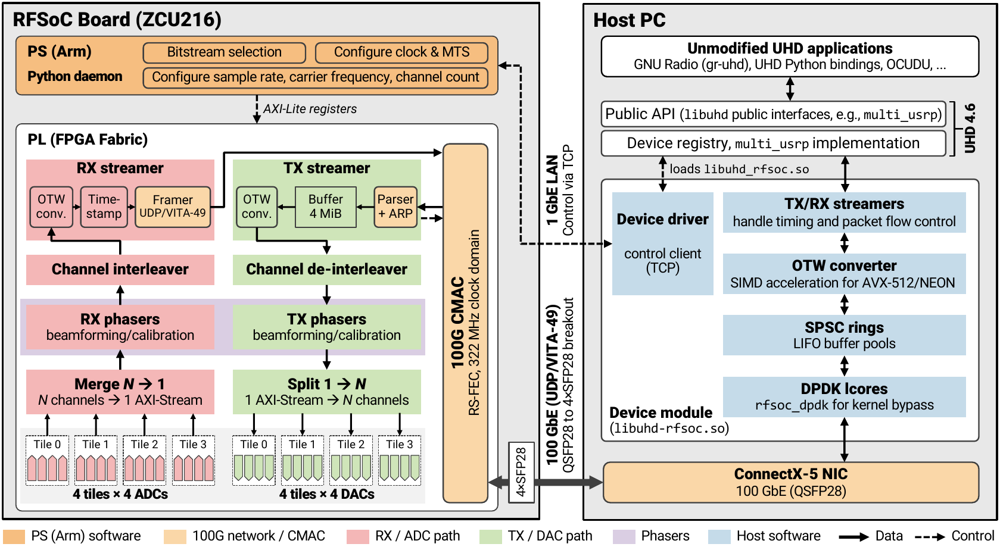

# uhd-rfsoc

[](https://github.com/functions-lab/uhd-rfsoc/actions/workflows/ci.yml)

**Unleash the full capability of your RFSoC with uhd-rfsoc.**

**TL;DR:** uhd-rfsoc is an RFSoC driver for UHD, so you can use your board
as a standard UHD device. Every ecosystem built around UHD (GNU Radio,
OCUDU, Duranta and more) works out of the box.

Supported boards, each with multiple sample-rate and channel-count options:

- [**Xilinx RFSoC ZCU216**](https://www.amd.com/en/products/adaptive-socs-and-fpgas/evaluation-boards/zcu216.html) (16T16R)
- [**Real Digital RFSoC4x2**](https://www.realdigital.org/hardware/rfsoc-4x2) (2T4R)
- **Other Xilinx RFSoC boards**: Work in progress
<!-- Demo video placeholder. Replace the block below with the video: drag
     the .mp4 into the GitHub editor, or link a thumbnail to it. -->
> **Demo video.**

```sh
uhd_find_devices --args type=rfsoc
uhd_usrp_probe --args type=rfsoc,channels=4
benchmark_rate --args type=rfsoc --rx_rate 1.25e9 --tx_rate 1.25e9
```

## Architecture



## Quick start

**[QUICK_START.md](QUICK_START.md)** helps you jump start a RFSoC board with fresh PYNQ image and run a GNU Radio demo with uhd-rfsoc.

## Sampling rate options

The data rate $(R)$ on the 100 GbE link (connecting your radio and host machine) is the channel count $(N)$ times the per-channel I/Q sample rate $(f_s)$ times the size of one sample on the wire $(b_{\text{otw}})$:

$$R = N \cdot f_s \cdot b_{\text{otw}} \;\le\;100\ \text{Gb/s}$$

| symbol | meaning |
|---|---|
| $N$ | channel count |
| $f_s$ | per-channel I/Q sample rate, which is also the bandwidth |
| $b_{\text{otw}}$ | bits per I/Q sample of the over-the-wire (OTW) format: 32 for sc16, 24 for sc12, 16 for sc8 |

Example with $N = 4$ on a ZCU216:

| $f_s$ (MS/s) | sc16 | sc12 | sc8 | formats that fit |
|---|---|---|---|---|
| 625 | 80 Gb/s | 60 Gb/s | 40 Gb/s | sc16, sc12, sc8 |
| 833.33 | 107 Gb/s (x) | 80 Gb/s | 53 Gb/s | sc12, sc8 |
| 1250 | 160 Gb/s (x) | 120 Gb/s (x) | 80 Gb/s | sc8 only |

Choose the channel count with the device argument `channels=N` and the
sample rate with `--tx_rate` and `--rx_rate`:

```sh
# 4 channels at 625 MS/s each, sc16 (the default format)
benchmark_rate --args type=rfsoc,channels=4 --channels 0,1,2,3 --rx_rate 625e6 --tx_rate 625e6
# 4 channels at 1250 MS/s each: only sc8 fits
benchmark_rate --args type=rfsoc,channels=4,otw=sc8 --channels 0,1,2,3 --rx_rate 1.25e9
```

Available sampling rate options:

- **Bold** rates are the LTE / 5G NR rates.
- ${\color{orange}\textsf{Orange}}$ rates are only available for sc12 or sc8. ${\color{red}\textsf{Red}}$ rates are only available for sc8.
- Uncoloured rates fit in every format.

| board | f_RFDC (GS/s) | carrier (MHz) | channels | max f_s in sc16 / sc12 / sc8 (MS/s) | supported f_s per channel (MS/s) |
|---|---|---|---|---|---|
| **ZCU216** | 2.5 | 0 .. 1250 | 1 | 1250 / 1250 / 1250 | 62.5, 104.17, 125, 156.25, 208.33, 250, 312.5, 416.67, 500, 625, 833.33, 1250 |
| | | | 2 | 1250 / 1250 / 1250 | 62.5, 104.17, 125, 156.25, 208.33, 250, 312.5, 416.67, 500, 625, 833.33, 1250 |
| | | | 4 | 625 / 833.33 / 1250 | 62.5, 104.17, 125, 156.25, 208.33, 250, 312.5, 416.67, 500, 625, ${\color{orange}\textsf{833.33}}$, ${\color{red}\textsf{1250}}$ |
| | | | 8 | 312.5 / 500 / 625 | 62.5, 104.17, 125, 156.25, 208.33, 250, 312.5, ${\color{orange}\textsf{416.67}}$, ${\color{orange}\textsf{500}}$, ${\color{red}\textsf{625}}$ |
| | | | 16 | 156.25 / 250 / 312.5 | 62.5, 104.17, 125, 156.25, ${\color{orange}\textsf{208.33}}$, ${\color{orange}\textsf{250}}$, ${\color{red}\textsf{312.5}}$ |
| | 2.4576 | 0 .. 1228.8 | 1 | 1228.8 / 1228.8 / 1228.8 | **61.44**, 102.4, **122.88**, 153.6, 204.8, **245.76**, 307.2, 409.6, **491.52**, 614.4, 819.2, 1228.8 |
| | | | 2 | 1228.8 / 1228.8 / 1228.8 | **61.44**, 102.4, **122.88**, 153.6, 204.8, **245.76**, 307.2, 409.6, **491.52**, 614.4, 819.2, 1228.8 |
| | | | 4 | 614.4 / 819.2 / 1228.8 | **61.44**, 102.4, **122.88**, 153.6, 204.8, **245.76**, 307.2, 409.6, **491.52**, 614.4, ${\color{orange}\textsf{819.2}}$, ${\color{red}\textsf{1228.8}}$ |
| | | | 8 | 307.2 / 491.52 / 614.4 | **61.44**, 102.4, **122.88**, 153.6, 204.8, **245.76**, 307.2, ${\color{orange}\textsf{409.6}}$, ${\color{orange}\textsf{\textbf{491.52}}}$, ${\color{red}\textsf{614.4}}$ |
| | | | 16 | 153.6 / 245.76 / 307.2 | **61.44**, 102.4, **122.88**, 153.6, ${\color{orange}\textsf{204.8}}$, ${\color{orange}\textsf{\textbf{245.76}}}$, ${\color{red}\textsf{307.2}}$ |
| | 2.4 | 0 .. 1200 | 1 | 1200 / 1200 / 1200 | 60, 100, 120, 150, 200, 240, 300, 400, 480, 600, 800, 1200 |
| | | | 2 | 1200 / 1200 / 1200 | 60, 100, 120, 150, 200, 240, 300, 400, 480, 600, 800, 1200 |
| | | | 4 | 600 / 800 / 1200 | 60, 100, 120, 150, 200, 240, 300, 400, 480, 600, ${\color{orange}\textsf{800}}$, ${\color{red}\textsf{1200}}$ |
| | | | 8 | 300 / 480 / 600 | 60, 100, 120, 150, 200, 240, 300, ${\color{orange}\textsf{400}}$, ${\color{orange}\textsf{480}}$, ${\color{red}\textsf{600}}$ |
| | | | 16 | 150 / 240 / 300 | 60, 100, 120, 150, ${\color{orange}\textsf{200}}$, ${\color{orange}\textsf{240}}$, ${\color{red}\textsf{300}}$ |
| **RFSoC 4x2** | 5.0 | 0 .. 2500 | 1 | 2500 / 2500 / 2500 | 125, 208.33, 250, 312.5, 416.67, 500, 625, 833.33, 1000, 1250, 1666.67, 2500 |
| | | | 2 | 1250 / 1666.67 / 2500 | 125, 208.33, 250, 312.5, 416.67, 500, 625, 833.33, 1000, 1250, ${\color{orange}\textsf{1666.67}}$, ${\color{red}\textsf{2500}}$ |
| | 4.9152 | 0 .. 2457.6 | 1 | 2457.6 / 2457.6 / 2457.6 | **122.88**, 204.8, **245.76**, 307.2, 409.6, **491.52**, 614.4, 819.2, 983.04, 1228.8, 1638.4, 2457.6 |
| | | | 2 | 1228.8 / 1638.4 / 2457.6 | **122.88**, 204.8, **245.76**, 307.2, 409.6, **491.52**, 614.4, 819.2, 983.04, 1228.8, ${\color{orange}\textsf{1638.4}}$, ${\color{red}\textsf{2457.6}}$ |
| | 4.8 | 0 .. 2400 | 1 | 2400 / 2400 / 2400 | 120, 200, 240, 300, 400, 480, 600, 800, 960, 1200, 1600, 2400 |
| | | | 2 | 1200 / 1600 / 2400 | 120, 200, 240, 300, 400, 480, 600, 800, 960, 1200, ${\color{orange}\textsf{1600}}$, ${\color{red}\textsf{2400}}$ |

Note:

- **The OTW format is sc16 by default.** Pass the device argument `otw=sc8`
  or `otw=sc12` to ask for the type you want.

## GNU Radio demo

The 4-channel GNU Radio flowgraph with uhd-rfsoc, each DAC cabled to its ADC: 625 MS/s
per channel in sc16 type, a 10 MHz tone on a carrier frequency.

| GNU Radio flowgraph | Spectrum of RX 0-3 | RX 0-3 with TX shifted 90° apart |
|:---:|:---:|:---:|
|  |  |  |

- **Standard UHD blocks only:** UHD USRP Sink and Source, Qt GUI sinks.
- **Spectrum:** Clean tone at expected frequency band.
- **Phaser control:** one phase per TX and RX channel

## 5G NR with OCUDU and Duranta

Two open-source 5G RAN stacks, [OCUDU](https://ocudu.org) and
[Duranta](https://lfnetworking.org/projects/duranta/), run unmodified as Split 8
gNBs with an RFSoC board as their radio.


- **Pairs 1-4, over cable:** OCUDU gNB and srsUE on a 20 MHz FDD cell in
  band n28. The RFSoC boards run at 122.88 MS/s, the USRP X310 at
  23.04 MS/s.
- **Pairs 5-8, over the air:** a commodity phone on a 100 MHz TDD cell in
  band n78 at 3609.99 MHz, the second Nyquist zone of the RFSoC 4x2.
- **Hosts:** an x86 workstation, or an Arm-based NVIDIA DGX Spark.